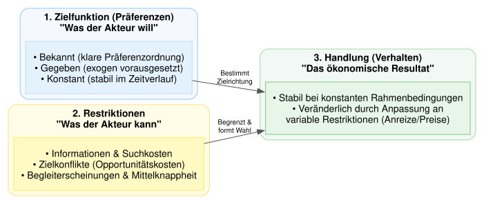
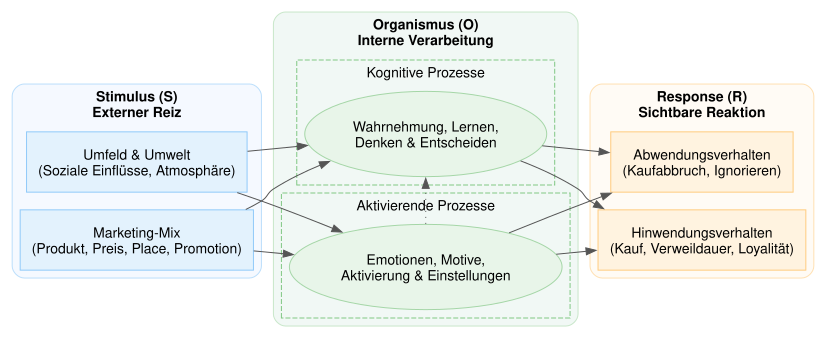

# Effizienz auf Märkten

-   Unter den Bedingungen des vollkommenen Wettbewerbs führen Märzte zu Effizienz

-   Bedingungen:

    -   vollständige Information
    -   Akteure handeln rational
    -   homogene Güter
    -   keine externen Effekte
    -   keine zeitlichen, örtilichen Präferenzen
    -   Abwesenheit von Marktmacht auf *beiden* Marktseiten (atomistische Marktstruktur)
    -   unendliche Reaktionsgeschwindigkeit
    -   keine Transaktionskosten

## Effizienzbedingungen Konsumsphäre

Gleiche Grenzraten der Substitution: $$MRS^A_{x_1, x_2}=MRS^B_{x_1, x_2}$$

## Effizienzbedingungen Produktionssphäre

Gleiche Grenzraten der technischen Substitution: $$MRTS^{x_1}_{L, K}=MRTS^{x_2}_{L, K}$$

## Effizienzbedingungen Abstimmung zwischen beiden Sphären

Grenzrate der Subsitution entspricht Grenzrate der Transformation $$MRS^A_{x_1, x_2}=MRS^B_{x_1, x_2}=MRT_{x_1, x_2}$$

## Wirtschaftspsychologische Ergänzung

-   Nutzenfunktion wird in der Ökonomik $U=U(x_1, x_2,\dots, x_n)$ wird als gegeben und konstant unterstellt

-   Aus psychologischer Sicht kann sich die Zusammensetzung der Nutzenfunktion und insbesondere die Gewichtung der Elemente $x_1, x_2, \dots, x_n$ im Zeitablauf ändern und situationsabhängig sein.

-   Einzelne Güter kann man sich als Bündel von Produkteigenschaften vorstellen: $X_j=X_j(x_1, x_2, \dots. x_n)$

-   Die subjektive Vorstellung darüber, welche Produkteigenschaften ein einzelnes Gut aufweist und inwiefern diese zur Nutzenfunktion passen, ist abhängig vom subjektiven Informationsstand, von Interpretation und kann auch in der Zeit variieren.

### Nutzenmaximierung unter Nebenbedingungen

```{python}
#| output: false

import graphviz
# from IPython.display import display, SVG

# Digraph im fließenden S-O-R-Stil initialisieren
dot = graphviz.Digraph(comment='Rationale Nutzenmaximierung (Prozessmodell)', format='svg')
dot.attr(rankdir='LR', size='12,5', fontname='Helvetica')
dot.attr('node', fontname='Helvetica', style='filled', margin='0.2')

# Farbpalette passend zum S-O-R-Stil
pref_color = '#E3F2FD'   # Sanftes Blau (Zielfunktion / Präferenzen)
restr_color = '#FFF9C4'  # Sanftes Gelb/Amber (Restriktionen / Grenzen)
action_color = '#E8F5E9' # Sanftes Grün (Handlung / Verhalten)

# 1. Cluster: Zielfunktion (Präferenzen)
with dot.subgraph(name='cluster_ziel') as c:
    c.attr(label='1. Zielfunktion (Präferenzen)\n"Was der Akteur will"', 
           style='rounded,filled', color='#90CAF9', fillcolor='#F5F9FF', fontname='Helvetica-Bold')
    c.node('ziel', '• Bekannt (klare Präferenzordnung)\n• Gegeben (exogen vorausgesetzt)\n• Konstant (stabil im Zeitverlauf)', 
           shape='box', fillcolor=pref_color, color='#BBDEFB', align='left')

# 2. Cluster: Restriktionen (Handlungsrahmen)
with dot.subgraph(name='cluster_restr') as c:
    c.attr(label='2. Restriktionen\n"Was der Akteur kann"', 
           style='rounded,filled', color='#FFE082', fillcolor='#FFFDE7', fontname='Helvetica-Bold')
    c.node('restr', '• Informationen & Suchkosten\n• Zielkonflikte (Opportunitätskosten)\n• Begleiterscheinungen & Mittelknappheit', 
           shape='box', fillcolor=restr_color, color='#FFEE58', align='left')

# 3. Cluster: Handlung (Ergebnis)
with dot.subgraph(name='cluster_handlung') as c:
    c.attr(label='3. Handlung (Verhalten)\n"Das ökonomische Resultat"', 
           style='rounded,filled', color='#A5D6A7', fillcolor='#F1F8F5', fontname='Helvetica-Bold')
    c.node('handlung', '• Stabil bei konstanten Rahmenbedingungen\n• Veränderlich durch Anpassung an\n  variable Restriktionen (Anreize/Preise)', 
           shape='box', fillcolor=action_color, color='#81C784', align='left')

# Logische Wirkungskanten (fließender Übergang)
dot.edge('ziel', 'handlung', label=' Bestimmt\n Zielrichtung', color='#555555', fontname='Helvetica', fontsize='10')
dot.edge('restr', 'handlung', label=' Begrenzt &\n formt Wahl', color='#555555', fontname='Helvetica', fontsize='10')

# Als SVG-Datei im Arbeitsverzeichnis speichern
output_filename = 'nutzenmaximierung_fluss'
dot.render(filename=output_filename, cleanup=True)

# Direkt in Jupyter / IPython anzeigen
# display(SVG(filename=f'{output_filename}.svg'))
```




### SOR-Modell der Wirtschaftspsychologie


```{python}
#| output: false

import graphviz
# from IPython.display import display, SVG

# Erstellen des Graphviz Digraphs
dot = graphviz.Digraph(comment='Stimulus-Organism-Response (S-O-R) Modell', format='svg')
dot.attr(rankdir='LR', size='12,6', fontname='Helvetica')
dot.attr('node', fontname='Helvetica', style='filled', margin='0.2')

# Farbpalette für die Phasen
stimulus_color = '#E3F2FD'  # Sanftes Blau
organism_color = '#E8F5E9'  # Sanftes Grün
response_color = '#FFF3E0'  # Sanftes Orange

# 1. Stimulus (S) Cluster
with dot.subgraph(name='cluster_S') as c:
    c.attr(label='Stimulus (S)\nExterner Reiz', style='rounded,filled', color='#BBDEFB', fillcolor='#F5F9FF', fontname='Helvetica-Bold')
    c.node('S1', 'Marketing-Mix\n(Produkt, Preis, Place, Promotion)', shape='box', fillcolor=stimulus_color, color='#90CAF9')
    c.node('S2', 'Umfeld & Umwelt\n(Soziale Einflüsse, Atmosphäre)', shape='box', fillcolor=stimulus_color, color='#90CAF9')

# 2. Organismus (O) Cluster mit Unterteilungen
with dot.subgraph(name='cluster_O') as c:
    c.attr(label='Organismus (O)\nInterne Verarbeitung', style='rounded,filled', color='#C8E6C9', fillcolor='#F1F8F5', fontname='Helvetica-Bold')
    
    with c.subgraph(name='cluster_O_aff') as o_aff:
        o_aff.attr(label='Aktivierende Prozesse', style='dashed', color='#81C784', fontname='Helvetica')
        o_aff.node('O_aff', 'Emotionen, Motive,\nAktivierung & Einstellungen', shape='ellipse', fillcolor=organism_color, color='#A5D6A7')
        
    with c.subgraph(name='cluster_O_kog') as o_kog:
        o_kog.attr(label='Kognitive Prozesse', style='dashed', color='#81C784', fontname='Helvetica')
        o_kog.node('O_kog', 'Wahrnehmung, Lernen,\nDenken & Entscheiden', shape='ellipse', fillcolor=organism_color, color='#A5D6A7')

# 3. Response (R) Cluster
with dot.subgraph(name='cluster_R') as c:
    c.attr(label='Response (R)\nSichtbare Reaktion', style='rounded,filled', color='#FFE0B2', fillcolor='#FFFBF5', fontname='Helvetica-Bold')
    c.node('R1', 'Hinwendungsverhalten\n(Kauf, Verweildauer, Loyalität)', shape='box', fillcolor=response_color, color='#FFCC80')
    c.node('R2', 'Abwendungsverhalten\n(Kaufabbruch, Ignorieren)', shape='box', fillcolor=response_color, color='#FFCC80')

# Kanten (Verbindungen) definieren
dot.edge('S1', 'O_aff', color='#555555')
dot.edge('S1', 'O_kog', color='#555555')
dot.edge('S2', 'O_aff', color='#555555')
dot.edge('S2', 'O_kog', color='#555555')

# Interne Interaktion im Organismus
dot.edge('O_aff', 'O_kog', style='dotted', color='#555555', constraint='false')

# Verbindungen zum Response
dot.edge('O_aff', 'R1', color='#555555')
dot.edge('O_kog', 'R1', color='#555555')
dot.edge('O_aff', 'R2', color='#555555')
dot.edge('O_kog', 'R2', color='#555555')

# Als SVG speichern (erzeugt 'sor_model.svg')
output_filename = 'sor_model'
dot.render(output_filename, cleanup=True)

# In Jupyter/IPython anzeigen
# display(SVG(filename=f'{output_filename}.svg'))
```


